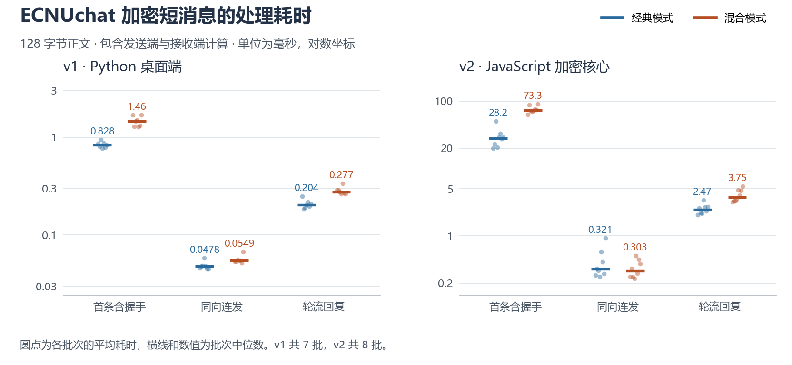

# ECNUchat 加密资源开销实测

相同目录缓存下的 v2 流量与计算耗时见[三组对照报告](../../output/pdf/ECNUchat-通信流量优化报告.pdf)。下文的 v1 数据采自制作报告时的 Windows 工作区。此分支沿用原有 v1 客户端，复跑时可用 `v1.json` 中的源码 SHA-256 区分版本。源码摘要按当时文件的原始字节计算，会随 Git 检出的换行格式变化。

后续的[混合信封引用实测](pq-reference.md)记录了启用接收端确认后的流量、丢包、乱序和重启结果。下文数据保留为每封都携带完整封装的基线。

2026-11-26，在同一台 Windows 11 笔记本（Intel Core i7-14650HX，16 核 24 线程，约 16 GiB 内存）运行仓库中的 Python v1 和 v2 JavaScript 加密实现。每条消息都由一端发送、另一端解密并核对正文。两端共用一个进程。

**128 字节的短消息，混合模式的额外计算主要发生在建会话和轮流回复时。** v2 的首条消息从 28.16 ms 增至 73.34 ms，轮流回复从 2.47 ms 增至 3.75 ms。同一人连续发送时，两种模式均约 0.3 ms。带宽开销持续存在，v2 每条后续消息增加 1,450 B，发送 1,000 条约多 1.38 MiB 应用层数据。



## 电池实验：额外耗电能否测出来？

**这次笔记本电池读数无法可靠分辨两种模式的额外耗电。** v2 在已建立的会话里以每秒 10 条、每条 128 字节交替收发。每轮测空闲、经典和混合三种状态，各持续 22.5 秒。共做 4 轮，经典与混合各有两轮先测，每种加密模式实际完成 900 条。Windows 电池计量器每两秒采样，舍去每段前 6 秒，用约第 6 至 22 秒的有效读数做梯形积分。

| 轮次 | 空闲（W） | 经典（W） | 混合（W） | 本轮混合减经典（W） |
|---|---:|---:|---:|---:|
| 1 | 45.25 | 34.78 | 26.40 | −8.37 |
| 2 | 34.57 | 26.05 | 31.50 | +5.46 |
| 3 | 53.03 | 35.49 | 26.98 | −8.52 |
| 4 | 49.76 | 76.21 | 110.42 | +34.22 |
| 四轮均值 | 45.65 | 43.13 | 48.83 | +5.70 |

四轮功率差两正两负，样本标准差为 20.11 W，大于平均差值 5.70 W。第四轮的高读数显著影响均值，其原因无法从电池计量器区分。12 个测量窗口中有 2 个窗口的功率读数始终相同。这是包含 CPU、显示屏、其他进程等负载的**整机放电功率**。据此无法给出每条消息额外耗费的焦耳数，也无法推算手机续航减少的百分比。

## 每条消息的耗时、CPU 和大小

正文为 128 个 ASCII 字节。耗时是本机双端处理的墙钟时间。CPU 是同一进程含工作线程的累计 CPU 时间，并行计算时可大于墙钟时间。每行时间取重复批次的中位数，每个批次先用总时间除以成功消息数。报文字节取实测平均值，四舍五入到整字节。

| 客户端 | 模式及场景 | 耗时（ms/条） | CPU（ms/条） | 单封 JSON（B） |
|---|---|---:|---:|---:|
| v1 Python | 明文 JSON | 0.0055 | 0.0052 | 292 |
| v1 Python | 预共享 AES-256-GCM | 0.0142 | 0.0138 | 450 |
| v1 Python | 经典 · 首条 | 0.828 | 0.763 | 803 |
| v1 Python | 混合 · 首条 | 1.464 | 1.404 | 6,915 |
| v1 Python | 经典 · 同向连发 | 0.0478 | 0.0477 | 520 |
| v1 Python | 混合 · 同向连发 | 0.0549 | 0.0534 | 1,983 |
| v1 Python | 经典 · 轮流回复 | 0.204 | 0.198 | 519 |
| v1 Python | 混合 · 轮流回复 | 0.277 | 0.275 | 1,982 |
| v2 JS | 明文 JSON | 0.0026 | 0.0024 | 375 |
| v2 JS | 预共享 AES-256-GCM | 0.0827 | 0.130 | 489 |
| v2 JS | 经典 · 首条 | 28.16 | 27.25 | 855 |
| v2 JS | 混合 · 首条 | 73.34 | 86.00 | 6,954 |
| v2 JS | 经典 · 同向连发 | 0.321 | 0.417 | 585 |
| v2 JS | 混合 · 同向连发 | 0.303 | 0.488 | 2,035 |
| v2 JS | 经典 · 轮流回复 | 2.467 | 2.35 | 583 |
| v2 JS | 混合 · 轮流回复 | 3.751 | 4.10 | 2,033 |

**为何同向连发省计算，却仍然费流量？** 混合棘轮在创建新发送链时做 ML-KEM-768 封装，同一条链上的后续消息沿用封装结果。现有实现会把 1,088 字节的封装密文放进每个混合信封，Base64 编码后为 1,452 个字符。在 v2 中还要计入 JSON 引号以及经典模式同字段的 `null`，净增加 1,450 B。v1 经典信封省略该字段，混合模式净增加 1,463 B。

v2 同向连发的经典、混合两组批均值范围分别为 0.250–0.932 和 0.234–0.506 ms。两组重叠，不能从中位数差 0.018 ms 断定混合模式更快。v2 首条还包含联系人预密钥签名校验，混合接收端按当前应用路径验证对方目录返回的一整组后量子预密钥；首条的时间差包含这部分工作。

### 把正文增至 4,096 字节

同向连发时，经典与混合的报文大小差基本固定。v2 混合相对经典多出的比例从短消息的约 248% 降为约 25%。下表均为单条应用层信封字节数。

| 客户端与正文 | 明文 | 预共享 AES-GCM | 经典棘轮 | 混合棘轮 |
|---|---:|---:|---:|---:|
| v1 · 128 B | 292 | 450 | 520 | 1,983 |
| v1 · 4,096 B | 4,260 | 5,742 | 5,812 | 7,275 |
| v2 · 128 B | 375 | 489 | 585 | 2,035 |
| v2 · 4,096 B | 4,343 | 5,781 | 5,877 | 7,327 |

## 内存与会话状态

v2 用独立 Node 进程完成建会话和 64 条交替消息，每种模式启动 3 次。经典进程的峰值驻留内存中位数为 **55.7 MiB**，混合为 **59.5 MiB**，这一工作负载下相差约 **3.8 MiB**。数字包含运行时、两端身份及密钥生成时的暂存分配，不能乘以联系人数量估算内存。桌面窗口和浏览器进程的内存未纳入。

单看会话记录，v2 双端序列化后的总长度分别为 7,075 B 和 13,235 B，每端多 3,080 B。v1 在首条后再交替发送 32 条，两端记录总长从 4,160 B 增至 10,222 B。此处测的是将要存储的序列化字节数。

## 测量口径与复跑

- **对照组**。明文组序列化并解析聊天 JSON。AES 组预先共享密钥，每条使用独立 nonce，执行 AES-256-GCM 加密、认证解密和 JSON 编解码。这两组仅用于实验，没有更改客户端的加密配置。
- **协议组**。经典组使用 X3DH、双棘轮与 AES-GCM。混合组增加 ML-KEM-768 握手和混合棘轮。首条计时从已注册双方建新会话开始，到首条正文在接收端解开为止，每次建会话使用独立的一次性预密钥。同向连发固定 A→B，轮流回复按 B→A、A→B 交替，每次计一条。
- **计时范围**。Python 3.13.11、cryptography 50.0.2，调用 v1 的 ChatEngine 发送与解密路径。Node 24.22.3 直接执行 v2 客户端使用的 WebCrypto、TweetNaCl 和 ML-KEM 模块。两条路径都计入信封编解码。身份注册、补充预密钥、数据库、浏览器界面、信箱轮询和网络往返均排除。不同客户端的运行时、密码库和校验工作量不同，适合在各自实现内比较模式。
- **重复次数**。v1 预热后做 7 批，批内交替场景为 2,048 条、首条场景为 512 个独立会话。v2 预热后做 8 批，交替场景每批 40 条、首条每批 4 个独立会话。实际样本数、每批耗时与 CPU 记录均保存在原始数据中。图中的散点各代表一个批次，不代表单条消息的尾延迟。
- **报文边界**。v1 统计中继转发给接收方的 JSON 信封；v2 统计发送方提交给中继的 JSON 请求体。均不含目录查询、响应、HTTP/WebSocket 帧、传输压缩和网络重传。这些数字用于对比协议字段开销。文件分片和通话音频有独立的传输路径，不能套用文字信封的比例。

在仓库根目录依次运行以下命令。功耗实验需要笔记本使用电池供电，约持续五分钟。

```powershell
.\.venv\Scripts\python.exe scripts/benchmark_v1.py --output docs/benchmarks/v1.json
node scripts/benchmark_v2.js docs/benchmarks/v2.json
.\scripts\benchmark_power.ps1
```

在装有 Matplotlib 的 Python 环境运行 `python scripts/plot_crypto_benchmark.py`，可从原始批次重新生成上图。

[v1 原始批次](v1.json) · [v2 原始批次及内存记录](v2.json) · [电池原始读数](power.json)
